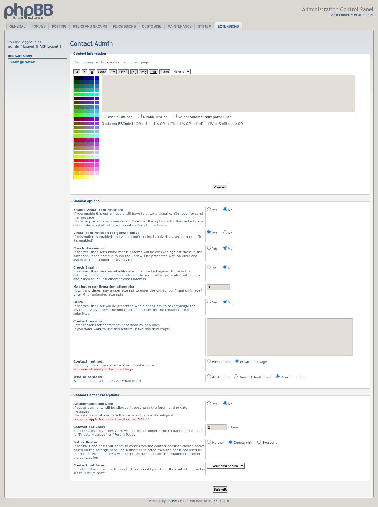
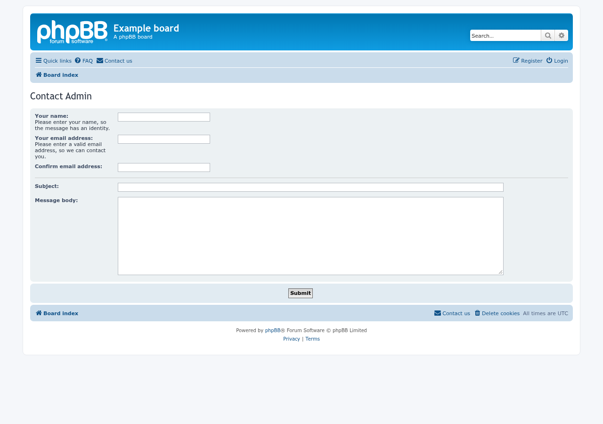
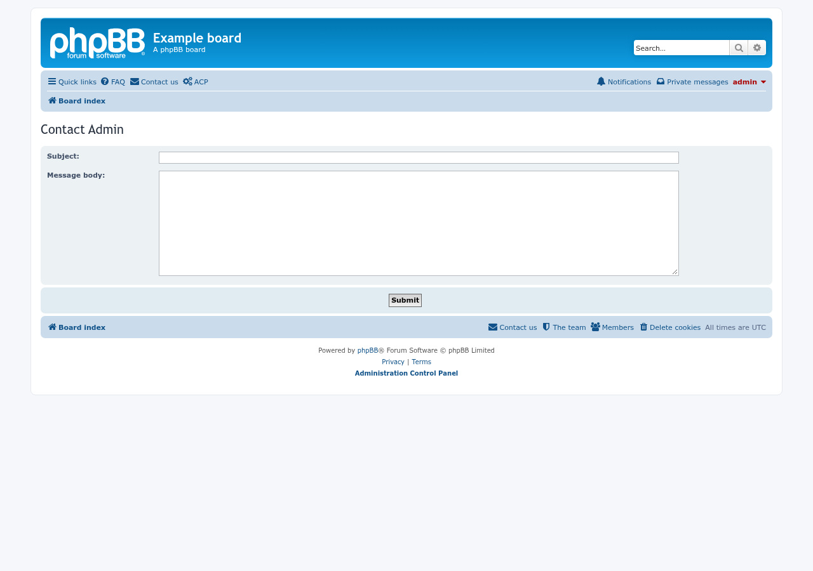

# Contact Admin screenshots

Captured with [phpbb-release-tools](https://github.com/phpbbmodders/phpbb-release-tools)’ `phpbb-test-board/screenshots.py` on a disposable phpBB 3.3.19 board. The examples use private-message delivery; no messages were sent.

## ACP configuration

## Guest contact form

## Signed-in contact form

