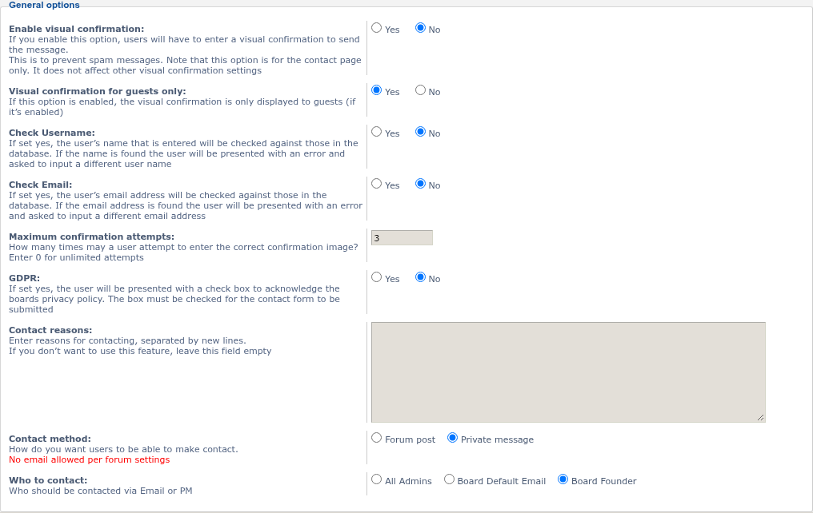
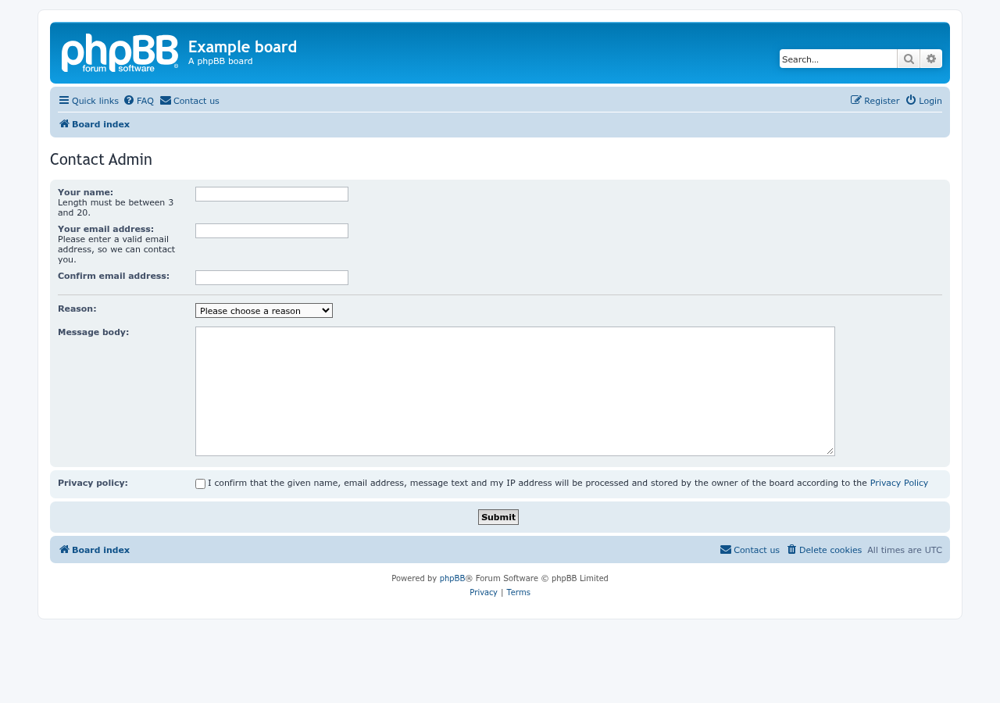
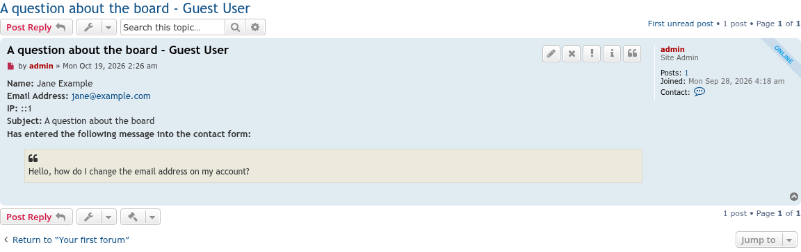

# Contact Admin update screenshots — 10/18/2026

Captured with [phpbb-release-tools](https://github.com/phpbbmodders/phpbb-release-tools)’ `phpbb-test-board/screenshots.py` on a disposable phpBB 3.3.19 board, with the board’s email turned off.

## Delivery settings

The contact method choices are now drawn by the extension’s own template; phpBB 4.0 removed the helper they used. The note under “Contact method” now appears when the board cannot send email.

## Guest form with the username check and privacy policy box

With “Check Username” on, guests now see the board’s username rules under “Your name”. The privacy policy box works with its label.

## A guest’s message posted by the contact bot

Messages from guests are labelled “Guest User” again when the contact bot posts them.

