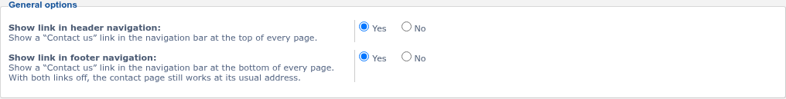
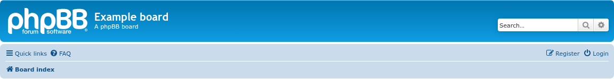

# Contact Admin update screenshots — 11/01/2026

Captured with [phpbb-release-tools](https://github.com/phpbbmodders/phpbb-release-tools)’ `phpbb-test-board/screenshots.py` on a disposable phpBB 3.3.19 board, with Contact Admin 1.6.2-dev.

## Navigation link settings

Two new settings under ACP » Extensions » Contact Admin turn the “Contact us” link in the header and in the footer on or off separately. Both start on.

## Header link turned off

With “Show link in header navigation” set to No, the header’s navigation bar ends at FAQ.

## Footer link kept

On the same board the footer still shows its “Contact us” link, highlighted here.

